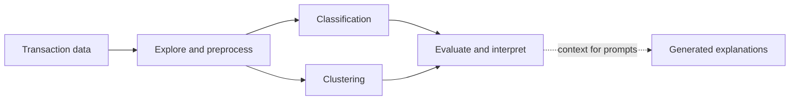
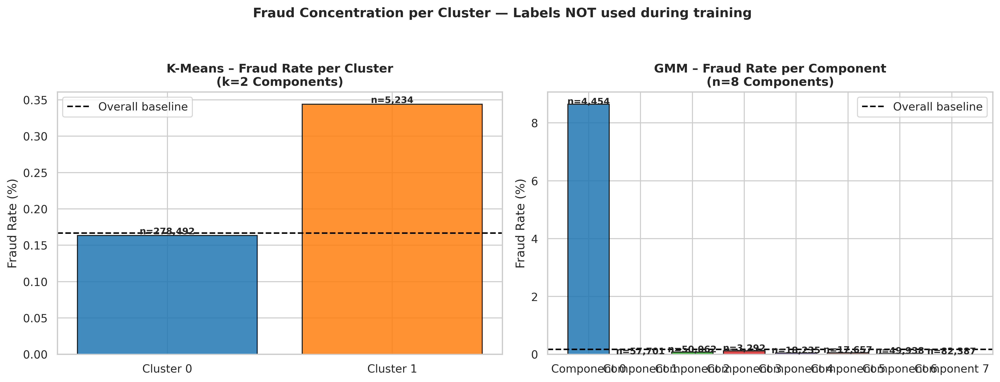

# Credit Card Fraud Detection

### Finding rare fraud patterns with machine learning


An artificial intelligence course project combining **fraud classification**, **transaction clustering**, and **LLM-generated explanations** on an imbalanced credit-card transaction dataset.

[Explore the models](Phase1_Supervised_Learning.ipynb) · [Explore clustering](Phase2_Unsupervised_Learning_.ipynb) · [Explore generative AI](Phase2_Generative_AI.ipynb)

## Project motivation

Credit card fraud causes financial losses for banks and customers, yet fraudulent transactions are rare compared with legitimate activity. This makes it easy for a model to achieve high accuracy while still missing the cases that matter most.

We chose this problem for its practical importance and technical challenges: handling highly imbalanced data, designing preprocessing steps, and selecting evaluation metrics that reflect fraud detection performance. The Kaggle Credit Card Fraud Detection dataset provides anonymized numerical transaction features and labeled fraud cases for classification, analysis, and pattern discovery.

## What this project explores

| Track | Approach | Focus |
| --- | --- | --- |
| Data exploration | Distribution analysis, duplicate removal, feature scaling | Understand the data and class imbalance |
| Supervised learning | Logistic Regression, Random Forest, XGBoost | Compare precision, recall, F1, and ROC-AUC |
| Unsupervised learning | K-Means, Gaussian Mixture Models, PCA visualizations | Discover transaction groups and fraud concentration |
| Generative AI | Groq, Llama 3.1, four prompt templates | Turn prediction context into readable explanations |



The notebooks explore these components separately; the diagram summarizes the project workflow rather than a deployed production pipeline.

## Recorded model comparison

The final comparison table saved in the supervised-learning notebook reports:

| Model | Precision | Recall | F1-score | ROC-AUC |
| --- | ---: | ---: | ---: | ---: |
| **XGBoost** | **0.9250** | **0.7789** | **0.8457** | **0.9705** |
| Random Forest | 0.9342 | 0.7474 | 0.8304 | 0.9337 |
| Logistic Regression | 0.8472 | 0.6421 | 0.7305 | 0.9568 |

XGBoost has the highest F1-score and recall in this saved comparison. The recorded test set contains **56,746 transactions, including 95 fraud cases**, and the classification code uses a **0.30 decision threshold**.

These are archived results, not a fresh benchmark. Some saved XGBoost cell outputs and narrative counts differ from the final table; rerun the notebook to obtain one consistent set of metrics. Accuracy alone is not highlighted because of the strong class imbalance.

## A closer look at the data



*Saved clustering visualization from the project. Cluster membership is exploratory and does not by itself establish that a transaction is fraudulent.*

More artifacts: [clustering plots](Unsupervised_Learning/clustering_results) · [evaluation report](Supervised_Learning/evaluation_results/evalution_matrix.pdf) · [supervised plots](Supervised_Learning/plots/plots.pdf)

## Generative AI component

Four prompt templates explore different ways to communicate a model result:

1. **Fraud explanation** — describe the prediction in accessible language.
2. **User advice** — generate suggested next steps.
3. **Risk interpretation** — present a qualitative risk category.
4. **Comparative analysis** — compare transaction contexts.

The notebook uses Groq with `llama-3.1-8b-instant` and evaluates saved responses using readability, response length, and keyword-based measures. User preference labels are simulated, not results from a real user study. Generated explanations and risk categories are not validated financial decisions.

[Prompt rationale](Generative_AI/docs/prompt_design_rationale.md) · [Saved outputs](Generative_AI/generative_ai_outputs.txt)

## Dataset

[Credit Card Fraud Detection on Kaggle](https://www.kaggle.com/datasets/mlg-ulb/creditcardfraud), provided by the Machine Learning Group at ULB.

The project dataset notes describe 284,807 anonymized transactions, including 492 fraud cases. `Class` is the target (`1` = fraud, `0` = legitimate). Download the data from the original source and follow its usage terms; raw and processed transaction files are not included here.

## Run the notebooks

```bash
git clone https://github.com/FatimaAlsaggaf/credit-card-fraud-detection.git
cd credit-card-fraud-detection
python -m venv .venv
# Activate .venv using the command for your operating system.
python -m pip install -r requirements.txt
jupyter lab
```

Run in this order:

1. `Phase1_Data_Exploration.ipynb` — load `creditcard.csv` and produce `creditcard_preprocessed.csv`.
2. `Phase1_Supervised_Learning.ipynb` — train and compare classifiers.
3. `Phase2_Unsupervised_Learning_.ipynb` — explore clusters using the preprocessed file.
4. `Phase2_Generative_AI.ipynb` — run prompt experiments with your own Groq key.

Keep the CSV files in the notebook working directory. The exploration notebook contains Kaggle shell commands and a Google Colab download cell; on a local machine, download the CSV manually and skip those platform-specific cells.

For generative AI, copy `.env.example` to `.env` and set `GROQ_API_KEY` locally. Never paste credentials into notebook cells or saved outputs. The requirements file lists libraries used by the notebooks; it is not a version-pinned environment from the original experiments.

## Scope and limitations

This is an academic exploration, not a production fraud-screening service. The public snapshot has not been retrained or validated end to end. A reproducible follow-up should fit all preprocessing only on training folds, reconcile saved outputs, and assess threshold selection and precision-recall trade-offs. In particular, the exploration notebook scales `Amount` before the supervised split, so the archived evaluation is not a fully isolated preprocessing benchmark.

## Team

Created for **SW485 — Group 8** by Khawlah Alawadi, Samiha Nasser, Ruba Fayez, Rana Alkhuraiji, Raghad Alyousfy, Aleen Alqasem, and Fatima Alsaggaf.

[Project references](Docs/references.md) 
